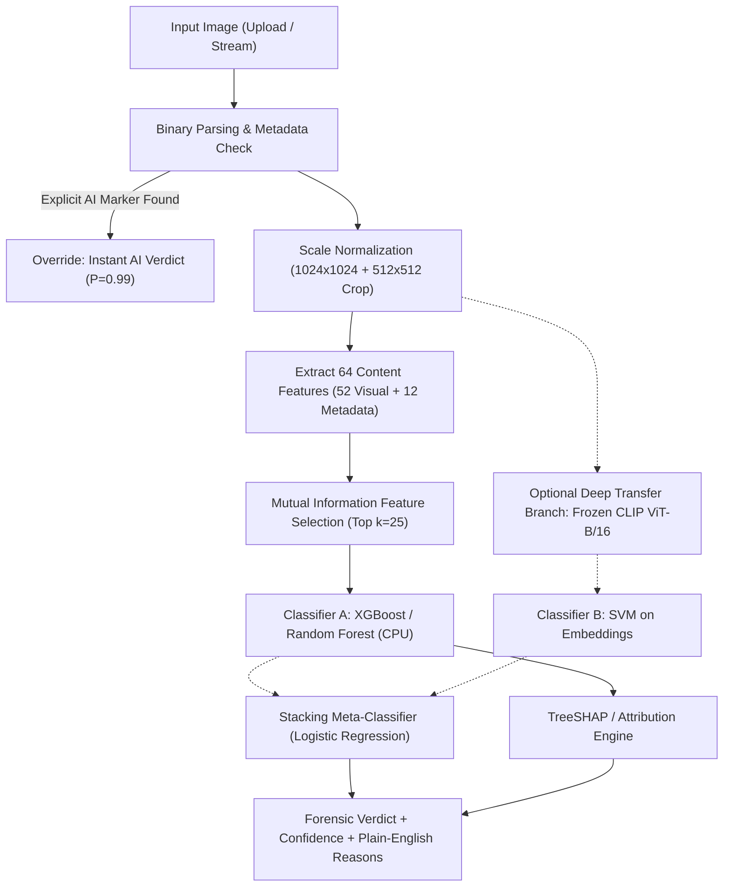

# AI-Generated Image Detection Using Metadata and Visual Feature Mining 🔍

[](https://share.streamlit.io)
[](https://www.python.org/)
[](https://opensource.org/licenses/MIT)

An interpretable, lightweight digital media forensics framework that determines whether an image is an authentic camera capture or AI-generated. Built as a course project for **PECST525 – Data Mining** at **Muthoot Institute of Technology and Science (MITS)**, APJ Abdul Kalam Technological University.

---

## 👥 Project Contributors
- **Gourinanda S Kumar** (MUT24CS068)
- **Hannah Elizabeth George** (MUT24CS069)
- **Swathy M Ram** (MUT24CS144)
- **Varghese Jibu** (MUT24CS147)
- **Faculty Guide**: Ms. Parvathy E. N.

---

## 📌 Problem & Motivation

Modern generative models (GANs, Stable Diffusion, Midjourney, DALL-E) produce photorealistic imagery virtually indistinguishable to the human eye, raising severe risks for disinformation, evidence tampering, and copyright infringement.

Existing automated detection systems rely predominantly on heavy end-to-end deep neural networks. While effective in controlled settings, they suffer from four major deficiencies:
1. **Computational Overhead**: Require high-end GPU clusters for both training and inference.
2. **Opacity (Black-Box)**: Output solitary probability scores with zero auditable evidence for forensic analysts.
3. **Information Neglect**: Ignore crucial file metadata (EXIF optical tags, editing signatures, C2PA/IPTC provenance).
4. **Vulnerability to Distribution Shift**: Overfit to specific training generator artifacts and degrade under everyday compression.

### The Solution:
A CPU-accessible, two-tier data mining system that combines:
- **Tier 1 (Forensic Metadata Mining)**: Header parsing for camera parameters, software signatures, prompt chunks, and C2PA/IPTC authenticity manifests.
- **Tier 2 (Visual Feature Mining)**: Handcrafted statistical descriptors across sensor noise residuals, spatial texture, 2-D spectral frequencies, and color distributions.
- **Explainable Decision Engine**: Plain-English justifications powered by game-theoretic TreeSHAP attributions.

---

## 🔬 Experimental Methodology & Pipeline



### 1. Scale Normalization & Leakage Removal
A critical finding during exploratory data mining on the **Kaggle AI Detection Dataset** (6,000 images: 3,000 authentic real, 3,000 synthetic):
- **Structural Leakage**: 100% of authentic camera images were pre-standardized to exactly 1024×1024 pixels, whereas 13.1% of AI images had variable dimensions (256 to 5,120 px).
- Models given raw dimensional features learned trivial file shortcuts rather than true forensic cues.
- **Remedy**: 9 superficial format shortcuts (`meta_is_jpeg`, `meta_width`, `meta_height`, `meta_aspect_ratio`, `meta_megapixels`, `meta_dims_ai_typical`, `meta_file_kb`, `meta_bytes_per_pixel`) were permanently stripped. All images are scale-normalized to 1024×1024 and features are extracted from the central 512×512 native crop.

### 2. Analytical Feature Families (64 Content Descriptors)
| Feature Family | Mined Attributes | Count |
| :--- | :--- | :---: |
| **Forensic Metadata** | EXIF camera make, model, lens, timestamp, GPS, software tag, ICC profile, generation prompt chunks, C2PA/IPTC tags | 12 |
| **Tone & Contrast** | Mean luminance, contrast standard deviation, Shannon entropy | 3 |
| **Sharpness & Edges** | Variance of Laplacian, Canny edge pixel density | 2 |
| **Sensor Noise Residuals** | Median filter noise residual ($R = I - \text{median}(I)$), robust MAD noise, block-wise noise and texture uniformity | 4 |
| **Spatial Texture** | Gray-Level Co-occurrence Matrix (GLCM: contrast, homogeneity, energy, correlation), Local Binary Patterns (LBP) entropy | 5 |
| **Color Distribution** | RGB channel means/stds/entropies, 8-bin RGB histograms, HSV saturation mean/std, unique-color ratio | 36 |
| **Spectral Frequency** | 2-D Fast Fourier Transform (FFT) mid-band and high-band spectral energy shares | 2 |

---

## 📊 Empirical Evidences and Results

The framework was evaluated on a benchmark of **6,000 images** (80% train: 4,800 images; 20% hold-out test: 1,200 images strictly isolated from feature selection and training).

### 1. Classifier Comparison (Hold-Out Test Set)
Non-linear tree ensembles demonstrated superior discrimination by capturing complex non-linear interactions across spatial textures and noise residuals:

| Classifier | CV F1 | CV AUC | Test Accuracy | Precision | Recall | F1 Score | AUC |
| :--- | :---: | :---: | :---: | :---: | :---: | :---: | :---: |
| **XGBoost (Best Content)** | **0.750** | **0.826** | **76.8%** | **0.753** | **0.797** | **0.774** | **0.852** |
| **Random Forest** | 0.731 | 0.805 | 75.8% | 0.750 | 0.773 | 0.761 | 0.832 |
| **SVM (RBF Kernel)** | 0.738 | 0.798 | 74.8% | 0.738 | 0.768 | 0.753 | 0.807 |
| **Logistic Regression** | 0.696 | 0.744 | 69.7% | 0.684 | 0.730 | 0.707 | 0.751 |
| **Decision Tree** | 0.683 | 0.708 | 68.8% | 0.660 | 0.772 | 0.712 | 0.736 |

---

### 2. Leakage Mitigation & Feature Ablation Study
Demonstrating why scale normalization and shortcut removal are vital for robust forensic deployment:

| Configuration / Feature Set | Features | Test / CV F1 | Test / CV AUC | Forensic Validity |
| :--- | :---: | :---: | :---: | :--- |
| **All Features (with format shortcuts)** | 73 | 0.714 | 0.809 | ⚠️ Inflated by image dimension shortcuts |
| **Content-Only (raw dimensions dropped)**| 64 | 0.799 | 0.881 | ⚠️ Variable scale artifacts remain |
| **Content-Only + Scale Normalization (Final)** | **64** | **0.774** | **0.852** | ✅ **True, leakage-free forensic signal** |
| Metadata Only (5-fold CV) | 12 | 0.268 | 0.501 | Chance-level (EXIF pre-stripped in web datasets) |
| Visual Features Only (5-fold CV) | 52 | 0.748 | 0.825 | Drives bulk of forensic discrimination |
| Combined Content Features (5-fold CV) | 64 | 0.750 | 0.826 | Optimal multi-modal balance |

---

### 3. Explainable vs. Deep Transfer vs. Stacked Ensemble
Evaluating the trade-off between CPU explainability and deep representation power:

| Model Architecture | Hardware | Test Accuracy | Hold-Out F1 | Hold-Out AUC | Explainability |
| :--- | :---: | :---: | :---: | :---: | :--- |
| **Explainable Handcrafted (XGBoost)** | **Standard CPU** | **76.8%** | **0.774** | **0.852** | Full SHAP Feature Attributions |
| **Deep Transfer Branch (CLIP + SVM)** | GPU / CPU | 95.9% | 0.959 | 0.995 | Black-Box Embedding Vectors |
| **Stacked Generalization Ensemble** | GPU / CPU | **96.1%** | **0.961** | **0.995** | Stacker Logits + SHAP Rationale |

*Confusion Matrix of the Stacked Ensemble on the 1,200 Hold-Out Test Set (600 Real, 600 AI):*
- **True Real (TN)**: 577 / 600 (96.2% specificity; only 23 false alarms)
- **True AI (TP)**: 576 / 600 (96.0% sensitivity; only 24 missed detections)

---

### 4. Key Feature Importance (What Gives AI Away?)
Global permutation importance rankings show that generative synthesis algorithms struggle most with **micro-texture coherence** and **stochastic sensor noise**:
1. **GLCM Homogeneity (`vis_glcm_homogeneity`, Importance: 0.13)**: AI images exhibit unnatural smoothness across complex textures.
2. **GLCM Contrast (`vis_glcm_contrast`, Importance: 0.09)**: Real photos display organic, micro-contrast variations from physical illumination.
3. **Color Quantization (`vis_unique_color_ratio`)**: Synthesized pixels show discrete histogram bin clustering.
4. **Noise Uniformity (`vis_noise_uniformity`)**: Genuine camera sensors have spatially varying PRNU noise; AI images display unnaturally uniform residuals.
5. **Canny Edge Density (`vis_edge_density`)**: Diffusion up-samplers introduce micro-blurring along high-contrast boundaries.

---

### 5. Robustness Under Social Media Compression
Testing resilience against simulated re-compression (JPEG quality 60 + 75% downscaling):
- **Clean Model on Clean Test Set**: 73.2% Accuracy, 0.815 AUC
- **Clean Model on Degraded Test Set**: 68.5% Accuracy, 0.764 AUC
- *Observation*: Mined statistical visual features drop by only **4.7 percentage points**, exhibiting stability against moderate compression without retraining.

---

### 6. Computational Efficiency
- **Feature Extraction & Training (All 5 Classifiers)**: `< 3 minutes` on a standard laptop CPU.
- **Inference Latency**: `< 0.8 seconds` per uploaded image on CPU.
- **Memory Footprint**: `< 150 MB` RAM for handcrafted pipeline (suitable for $0 free-tier cloud deployment).

---

## 🚀 Quickstart & Usage

### 1. Installation
Clone the repository and install requirements:
```bash
git clone https://github.com/Hannah-George/AiDetect.git
cd AiDetect
pip install -r requirements.txt
```

### 2. Run the Interactive Web App
```bash
streamlit run app.py
```
Open [http://localhost:8501](http://localhost:8501) in your browser.
- **Analyse Images Tab**: Drag and drop single or batch images to view the verdict, confidence score, full metadata table, and horizontal SHAP contribution charts.
- **Model Performance Tab**: Live view of hold-out evaluation metrics, ROC curves, confusion matrices, and ablation tables.

### 3. Test with Included Sample Images
Test the app instantly using the bundled test files:
- Real photos: `sample_images/real/`
- AI-generated images: `sample_images/ai/`

---

## 🚢 Deployment Guide

### Option 1: Streamlit Community Cloud (Recommended — Free & Instant)
1. Fork or push this repository to your GitHub account.
2. Visit [share.streamlit.io](https://share.streamlit.io) and sign in with GitHub.
3. Click **New app**, select this repository, set branch to `main`, and main file path to `app.py`.
4. Click **Deploy**. The pre-trained model bundle (`models/model.joblib`) is already packaged in the repo and will launch immediately.

### Option 2: Docker Container (Production)
```bash
# Build Docker image
docker build -t aidetect .

# Run container on port 8501
docker run -p 8501:8501 aidetect
```
Healthcheck endpoint is enabled at `http://localhost:8501/_stcore/health`.

---

## 📁 Repository Structure

```
├── app.py                      # Interactive Streamlit forensic dashboard
├── predict.py                  # End-to-end inference engine (image -> verdict + SHAP reasons)
├── features.py                 # Multi-domain feature extractors (metadata + 52 visual features)
├── explain.py                  # Game-theoretic SHAP and feature attribution generator
├── data.py                     # Dataset discovery, balanced sampling, and feature caching
├── train.py                    # 5-fold CV benchmark, ablation engine, and model export
├── models/                     # Trained weights & evaluation artifacts
│   ├── model.joblib            # Pre-trained explainable model bundle
│   ├── metrics.json            # Hold-out test scores and confusion matrix
│   ├── cv_results.csv          # 5-classifier benchmark results
│   ├── ablation.csv            # Feature family ablation scores
│   ├── feature_importance.csv  # Permutation importance rankings
│   ├── confusion_matrix.png    # Evaluation plot
│   ├── roc_curves.png          # ROC curves plot
│   └── feature_importance.png  # Top features bar chart
├── sample_images/              # Curated real and AI test images
│   ├── real/                   # Camera captures
│   └── ai/                     # Synthetic images
├── requirements.txt            # Production dependencies (headless OpenCV)
├── Dockerfile                  # Container definition for cloud deployment
├── runtime.txt                 # Python runtime version pin (3.11)
└── .streamlit/config.toml      # Headless server & dark UI configuration
```

---

## 📜 Alignment with UN Sustainable Development Goals (SDGs)
- **SDG 9 (Industry, Innovation & Infrastructure)**: Delivers an open-source, resource-efficient forensic tool operating on consumer CPUs without requiring expensive GPU clusters.
- **SDG 16 (Peace, Justice & Strong Institutions — Target 16.10)**: Promotes public access to reliable information by countering digital disinformation through auditable, transparent media forensics.
