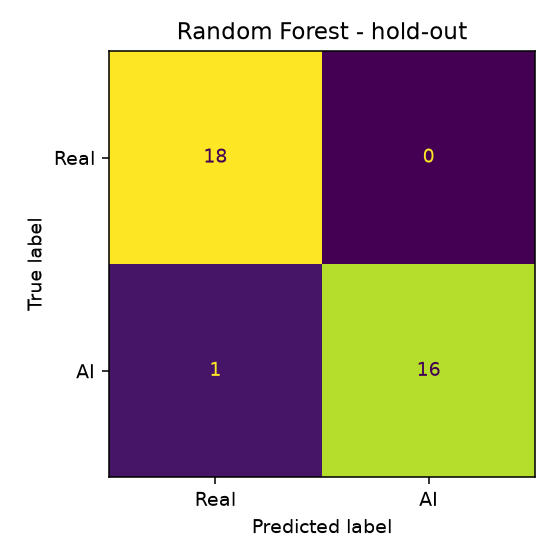
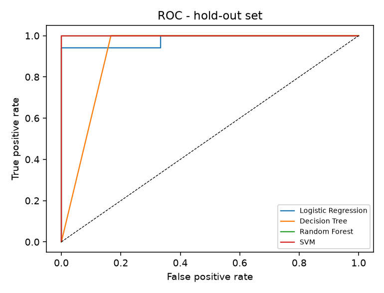
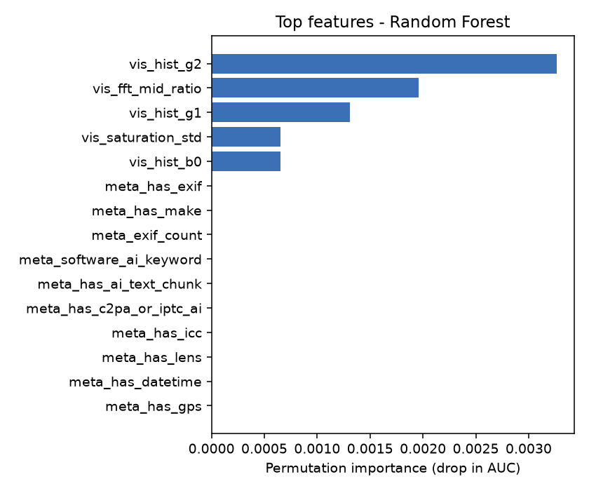

# AI-Generated Image Detection - Evaluation Report

Images: **174** (balanced) | Features mined: **64** | Kept after selection (mutual information): **25**

## Classifier comparison (5-fold CV on 80% train, then 20% hold-out)
| Model | CV F1 | CV F1 sd | CV AUC | Test Acc | Test Prec | Test Recall | Test F1 | Test AUC | ms/image (model) | Train s |
|---|---|---|---|---|---|---|---|---|---|---|
| Random Forest | 0.9857 | 0.0175 | 0.9959 | 0.9714 | 1.0000 | 0.9412 | 0.9697 | 1.0000 | 1.6360 | 3.8053 |
| SVM | 0.9783 | 0.0178 | 0.9949 | 0.9714 | 1.0000 | 0.9412 | 0.9697 | 1.0000 | 0.1091 | 0.9744 |
| Logistic Regression | 0.9857 | 0.0175 | 0.9837 | 0.9714 | 1.0000 | 0.9412 | 0.9697 | 0.9804 | 0.0577 | 0.7866 |
| Decision Tree | 0.9586 | 0.0398 | 0.9560 | 0.9143 | 0.8500 | 1.0000 | 0.9189 | 0.9167 | 0.0535 | 0.7955 |

**Selected model:** Random Forest (chosen on cross-validation AUC/F1; hold-out never used for selection)

## Hold-out performance of Random Forest
Accuracy 0.9714 | Precision 1.0000 | Recall 0.9412 | F1 0.9697 | AUC 1.0000

 

## Ablation - where does the signal come from?
| Feature set | n features | CV F1 | CV AUC |
|---|---|---|---|
| Metadata only | 12 | 0.7238 | 0.6684 |
| Visual only | 52 | 0.9857 | 0.9959 |
| Metadata + Visual | 64 | 0.9857 | 0.9959 |

> If *Metadata only* scores far above *Visual only*, the dataset likely leaks through file-format/EXIF
> differences (e.g. all real images are camera JPEGs, all AI images are stripped PNGs). Treat that score with caution
> and rely on the visual-only figure for generalisation.

## Top features (permutation importance)

## Selected features
vis_brightness, vis_contrast, vis_entropy, vis_texture_uniformity, vis_saturation_mean, vis_saturation_std, vis_r_mean, vis_r_std, vis_hist_r1, vis_hist_r2, vis_hist_r3, vis_hist_r4, vis_hist_r5, vis_hist_r7, vis_g_mean, vis_hist_g1, vis_hist_g2, vis_hist_g3, vis_b_mean, vis_b_hist_entropy, vis_hist_b0, vis_hist_b1, vis_hist_b3, vis_hist_b7, vis_fft_mid_ratio
